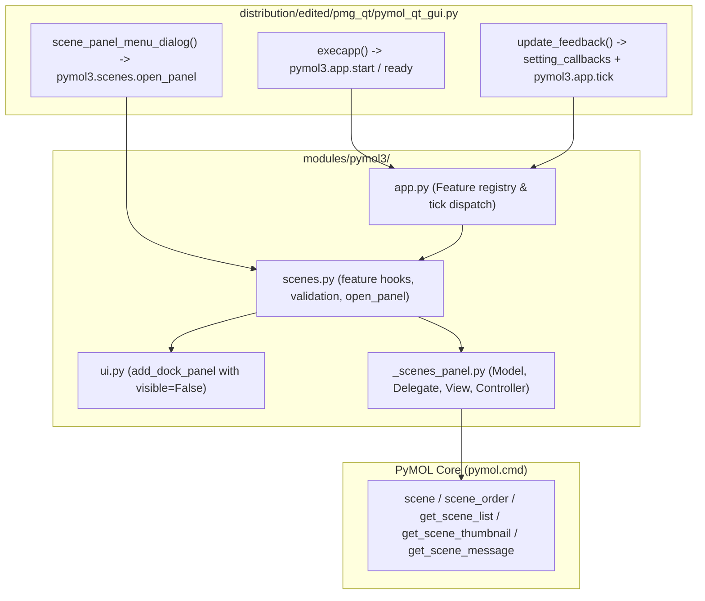

# Docked scenes panel implementation plan

> **For agentic workers:** REQUIRED SUB-SKILL: Use superpowers:subagent-driven-development (recommended) or superpowers:executing-plans to implement this plan task-by-task. Steps use checkbox (`- [ ]`) syntax for tracking.

**Goal:** A panel titled **Scenes** docked on the right lists every PyMOL scene with its thumbnail and name, scrolls when the list is long, and lets the user create, recall, update, rename, reorder by dragging, and remove scenes; it replaces PyMOL's floating Scenes window in the new GUI.

**Architecture:** `modules/pymol3/scenes.py` registers the feature through `pymol3.app` (without importing Qt at module import time) and drives a Qt list widget in `modules/pymol3/_scenes_panel.py` docked via `pymol3.ui.add_dock_panel(..., area="right", visible=False)`. Shared hooks (`visible` on `add_dock_panel` and `pymol3.app.tick` called from `PyMOLQtGUI.update_feedback`) land first, and a marked segment in `PyMOLQtGUI.scene_panel_menu_dialog` routes **Scene → Scenes…** to the docked panel in the new GUI while preserving classic behavior in the classic GUI.

**Architecture Diagram:**

**Tech Stack:** Python 3.13, `pymol.Qt` (PySide6 6.9 in the app), `pymol3.app`, `pymol3.ui`, Bazel (`rules_python`), pytest with Qt's `offscreen` platform.

**Spec:** [.opp/plans/features/scenes-panel.md](file:///home/hannah/github_repos/pymol-plus/.opp/plans/features/scenes-panel.md) (Issue #17).

## Global Constraints

- App: PySide6 stays at 6.9; Python 3.13.
- `distribution/edited/` holds upstream PyMOL files with marked edits (`BEGIN EDITED CODE SEGMENT`); no file under `modules/pymol/`, `modules/pmg_qt/`, `modules/pmg_tk/`, `modules/chempy/`, or `modules/pymol2/` changes.
- Never remove or change anything in PyMOL's existing command or Python API; only add.
- Python follows `opp-workflow:python-style` (2-space indent, 80-char line limit, `tmp_` locals, full-word names, docstrings on all functions/classes/attributes, `one-import`/`module-import`); `python3 .opp/style/check.py --committed` passes on the last push.
- Pull requests get the Bazel check only; `bazel test --lockfile_mode=off //...`, `bazel test --lockfile_mode=off //distribution/...`, and `bazel run --lockfile_mode=off //distribution:checks` pass.
- New files carry `SPDX-License-Identifier: BSD-3-Clause`.

## Review Focus

- **Rename to a name in use, empty name, or reserved key (`*`, `new`, `auto`).** PyMOL would silently overwrite another scene, delete the scene, or create a numbered scene; the panel refuses them, keeps the old name, and shows why inline and as a tooltip.
- **Sync loops.** Sending `scene_order` changes the scene list; the panel must not rebuild under a drag or re-send `scene_order` on subsequent ticks.
- **Thumbnail cost and zeroed buffers.** `MovieSceneStore` allocates `220 × 124 × 4` zero bytes before OpenGL redraw, and `.pse` sessions omit thumbnails (`b""`); thumbnails are validated with `QPixmap.loadFromData(..., "PNG")` and retried for at most 5 ticks per scene change, then idle ticks make 0 `get_scene_thumbnail` calls.
- **Messages lost on Update.** Updating a scene that is not on screen passes `message=cmd.get_scene_message(name)` explicitly so its message stays intact.
- **Selection vs. current scene and classic fallback.** Arrow keys, right-click, `F2`, `Delete`, and dragging never recall a scene; **Scene → Scenes…** opens the docked panel in the new GUI and keeps classic `ScenePanel` in the classic GUI.

## Scope

- `modules/pymol3/ui.py`
- `modules/pymol3/app.py`
- `modules/pymol3/scenes.py`
- `modules/pymol3/_scenes_panel.py`
- `distribution/edited/pmg_qt/pymol_qt_gui.py`
- `tests/pymol3_ui/test_ui.py`
- `tests/pymol3_app/conftest.py`
- `tests/pymol3_app/test_app.py`
- `tests/pymol3_scenes/__init__.py`
- `tests/pymol3_scenes/conftest.py`
- `tests/pymol3_scenes/test_scenes.py`
- `.opp/plans/features/scenes-panel.md`
- `.opp/plans/scenes-panel.md`

## Interfaces

- `pymol3.ui.add_dock_panel(widget, title, area="right", panel_id=None, floating=False, visible=True) -> DockPanel`
- `pymol3.app.TickCallback = Callable[["QtWidgets.QMainWindow", Sequence[str]], None]`
- `pymol3.app.Feature(name: str, start: Callback | None = None, ready: Callback | None = None, tick: TickCallback | None = None)`
- `pymol3.app.tick(window: QtWidgets.QMainWindow, feedback: Sequence[str] = ()) -> None`
- `pymol3.scenes`:
  - `FEATURE_NAME = "scenes_panel"`, `PANEL_ID = "scenes"`, `PANEL_TITLE = "Scenes"`
  - `RESERVED_SCENE_NAMES = frozenset({"*", "new", "auto"})`
  - `MAX_THUMBNAIL_RETRIES = 5`
  - `validate_scene_name(old_name: str, proposed_name: str, existing_names: Sequence[str]) -> tuple[str | None, str | None]`
  - `start(window)`, `ready(window)`, `tick(window, feedback=())`, `open_panel(window=None) -> bool`

---

### Task 1: `visible: bool = True` in `pymol3.ui.add_dock_panel`

**Files:**
- Modify: [ui.py](file:///home/hannah/github_repos/pymol-plus/modules/pymol3/ui.py)
- Modify: [test_ui.py](file:///home/hannah/github_repos/pymol-plus/tests/pymol3_ui/test_ui.py)

**Interfaces:**
- Produces: `add_dock_panel(..., visible: bool = True) -> DockPanel`

- [ ] **Step 1: Write the failing tests** in `tests/pymol3_ui/test_ui.py` (`test_visible_false_starts_hidden_and_unchecked`, `test_hidden_panel_tabs_cleanly_when_shown_beside_second_panel`).
- [ ] **Step 2: Run tests to verify they fail.**
  Run: `bazel test --lockfile_mode=off //tests --test_output=errors --test_arg=-k --test_arg="visible_false or hidden_panel_tabs"`
  Expected: FAIL (`unexpected keyword argument 'visible'`).
- [ ] **Step 3: Implement `visible: bool = True` in `modules/pymol3/ui.py`**.
- [ ] **Step 4: Run tests and style check.**
  Run: `bazel test --lockfile_mode=off //tests --test_output=errors` and `python3 .opp/style/check.py --base origin/production`
  Expected: PASS, 0 style findings.
- [ ] **Step 5: Commit.**
  `git commit -m "feat: let dock panels start hidden with visible=False"`

---

### Task 2: `pymol3.app.tick` and `PyMOLQtGUI.update_feedback` Hook

**Files:**
- Modify: [app.py](file:///home/hannah/github_repos/pymol-plus/modules/pymol3/app.py)
- Modify: [test_app.py](file:///home/hannah/github_repos/pymol-plus/tests/pymol3_app/test_app.py)
- Modify: [pymol_qt_gui.py](file:///home/hannah/github_repos/pymol-plus/distribution/edited/pmg_qt/pymol_qt_gui.py)

**Interfaces:**
- Produces: `TickCallback`, `Feature.tick`, `app.tick(window, feedback=())`

- [ ] **Step 1: Write the failing tests** in `tests/pymol3_app/test_app.py` (`test_classic_style_runs_no_tick`, `test_new_style_runs_tick_with_feedback`, `test_failing_tick_disables_feature_and_runs_others`, `test_feature_failed_in_start_skips_tick`).
- [ ] **Step 2: Run tests to verify they fail.**
  Run: `bazel test --lockfile_mode=off //tests --test_output=errors --test_arg=-k --test_arg=tick`
  Expected: FAIL (`tick` undefined / unexpected keyword `tick`).
- [ ] **Step 3: Implement `tick` in `modules/pymol3/app.py` and the marked segment in `PyMOLQtGUI.update_feedback`**.
- [ ] **Step 4: Run tests, edited tests, and style check.**
  Run: `bazel test --lockfile_mode=off //tests //distribution/edited:all --test_output=errors` and `python3 .opp/style/check.py --base origin/production`
  Expected: PASS, 0 style findings.
- [ ] **Step 5: Commit.**
  `git commit -m "feat: add pymol3.app.tick and wire PyMOLQtGUI.update_feedback"`

---

### Task 3: Core Scenes Panel — List, Thumbnails/Placeholders, `+`, Recall, Update, and Delete

**Files:**
- Create: `modules/pymol3/scenes.py`
- Create: `modules/pymol3/_scenes_panel.py`
- Create: `tests/pymol3_scenes/__init__.py`
- Create: `tests/pymol3_scenes/conftest.py`
- Create: `tests/pymol3_scenes/test_scenes.py`

**Interfaces:**
- Consumes: `pymol3.ui.add_dock_panel(..., visible=False)`, `pymol3.app.Feature`
- Produces: `pymol3.scenes` (`validate_scene_name`, `start`, `ready`, `tick`, `open_panel`, `FEATURE`) and `pymol3._scenes_panel` (`ScenesPanelWidget`, `ScenesController`, `_ScenesListModel`, `_SceneItemDelegate`, `_ScenesListView`, `PIXMAP_ROLE`, `IS_CURRENT_ROLE`).

- [ ] **Step 1: Write the failing tests** in `tests/pymol3_scenes/test_scenes.py` (`test_import_needs_no_qt_binding`, `test_empty_state_and_plus_creates_numbered_scenes`, `test_click_and_enter_recall_while_arrows_and_right_click_do_not`, `test_update_stores_current_screen_and_keeps_target_message`, `test_delete_via_row_button_key_and_context_menu`, `test_thumbnail_loads_valid_png_and_rejects_zero_buffer`).
- [ ] **Step 2: Run tests to verify they fail.**
  Run: `bazel test --lockfile_mode=off //tests --test_output=errors --test_arg=-k --test_arg=pymol3_scenes`
  Expected: FAIL (`No module named 'pymol3.scenes'`).
- [ ] **Step 3: Implement `modules/pymol3/scenes.py` and `modules/pymol3/_scenes_panel.py`**.
- [ ] **Step 4: Run tests and style check.**
  Run: `bazel test --lockfile_mode=off //tests --test_output=errors` and `python3 .opp/style/check.py --base origin/production`
  Expected: PASS, 0 style findings.
- [ ] **Step 5: Commit.**
  `git commit -m "feat: add scenes panel with create, recall, update and delete"`

---

### Task 4: Inline Rename Validation & Drag-and-Drop Reorder

**Files:**
- Modify: `modules/pymol3/scenes.py`
- Modify: `modules/pymol3/_scenes_panel.py`
- Modify: `tests/pymol3_scenes/test_scenes.py`

**Interfaces:**
- Consumes: `ScenesController`, `_ScenesListModel`, `_ScenesListView`, `validate_scene_name` (Task 3)
- Produces: `ScenesController.rename_scene`, `ScenesController.reorder_scene`, `_ScenesListModel.move_row`, inline rename editor + refusal feedback, drag-and-drop reorder via `cmd.scene_order(names, location="top")`.

- [ ] **Step 1: Write the failing tests** in `tests/pymol3_scenes/test_scenes.py` (`test_rename_via_f2_and_double_click_updates_pymol_preserving_spaces`, `test_rename_refuses_duplicate_empty_and_reserved_names`, `test_drag_reorder_updates_pymol_playback_order_once_without_recall`).
- [ ] **Step 2: Run tests to verify they fail.**
  Run: `bazel test --lockfile_mode=off //tests --test_output=errors --test_arg=-k --test_arg="rename or reorder"`
  Expected: FAIL.
- [ ] **Step 3: Implement inline rename validation/feedback and drag-and-drop reorder**.
- [ ] **Step 4: Run tests and style check.**
  Run: `bazel test --lockfile_mode=off //tests --test_output=errors` and `python3 .opp/style/check.py --base origin/production`
  Expected: PASS, 0 style findings.
- [ ] **Step 5: Commit.**
  `git commit -m "feat: support inline scene rename and drag-and-drop reorder"`

---

### Task 5: Live Sync, Bounded Thumbnail Retries, Auto-Open, Registration & `Scene → Scenes…` Hook

**Files:**
- Modify: `modules/pymol3/scenes.py`
- Modify: `modules/pymol3/_scenes_panel.py`
- Modify: `modules/pymol3/app.py`
- Modify: `tests/pymol3_app/conftest.py`
- Modify: `tests/pymol3_app/test_app.py`
- Modify: `distribution/edited/pmg_qt/pymol_qt_gui.py`
- Modify: `tests/pymol3_scenes/test_scenes.py`

**Interfaces:**
- Consumes: `pymol3.app.FEATURE_MODULES`, `PyMOLQtGUI.scene_panel_menu_dialog`
- Produces: `FEATURE_MODULES = ("pymol3.scenes",)`, `open_panel(window=None) -> bool`, bounded thumbnail retries (`MAX_THUMBNAIL_RETRIES = 5`), auto-open state machine, setting callbacks (`254` and `396`), and `scene_panel_menu_dialog` marked segment.

- [ ] **Step 1: Write the failing tests** in `tests/pymol3_scenes/test_scenes.py` and `tests/pymol3_app/test_app.py` (`test_default_feature_modules_includes_scenes`, `test_starts_hidden_auto_opens_once_and_stays_closed_after_close`, `test_auto_opens_on_session_with_scenes_and_respects_manual_close_before_scenes`, `test_external_scene_order_current_scene_and_reinitialize_sync`, `test_thumbnail_fetches_on_change_and_caps_retries_when_empty`, `test_scene_menu_hook_opens_panel_in_new_gui_and_falls_back_in_classic`).
- [ ] **Step 2: Run tests to verify they fail.**
  Run: `bazel test --lockfile_mode=off //tests --test_output=errors --test_arg=-k --test_arg="auto_opens or thumbnail_fetches or scene_menu_hook or default_feature_modules"`
  Expected: FAIL.
- [ ] **Step 3: Implement sync, bounded thumbnail retries, auto-open, `FEATURE_MODULES` registration, `tests/pymol3_app/conftest.py` isolation, and `scene_panel_menu_dialog` hook**.
- [ ] **Step 4: Run tests, edited tests, and style check.**
  Run: `bazel test --lockfile_mode=off //tests //distribution/edited:all --test_output=errors` and `python3 .opp/style/check.py --base origin/production`
  Expected: PASS, 0 style findings.
- [ ] **Step 5: Commit.**
  `git commit -m "feat: wire scenes panel sync, auto-open and Scene menu hook"`

---

## Verification

- `bazel test --lockfile_mode=off //...` passes (no `pymol3_*` tests skipped).
- `bazel test --lockfile_mode=off //distribution/...` passes (`edited_base_test` and `run_bundle_smoke_test` included).
- `bazel run --lockfile_mode=off //distribution:checks` passes (ruff, shellcheck, actionlint).
- `python3 .opp/style/check.py --base origin/production --committed` reports 0 findings.
- `git diff origin/production --stat` shows only files in `## Scope`.
